# Sentinel Hybrid SIEM Lab

I built this lab to get hands-on with Microsoft Sentinel. Two VMs run on my laptop (one Windows Server, one Ubuntu), get connected to Azure with Azure Arc, and send their security logs to Sentinel. From there I wrote my own detection rules, attacked my own machines to test them, and wrote a couple of scripts to automate the testing and reporting.

My original plan was to run the VMs in Azure. My subscription had no quota for the VM size I picked, so I ran them locally and connected them with Arc instead. That ended up being the more interesting setup, since that's how on-prem servers get monitored by a cloud SIEM in real environments.

---

## Setup

Everything in Azure is in one resource group, `rg-siem-lab`, so it's easy to tear down.

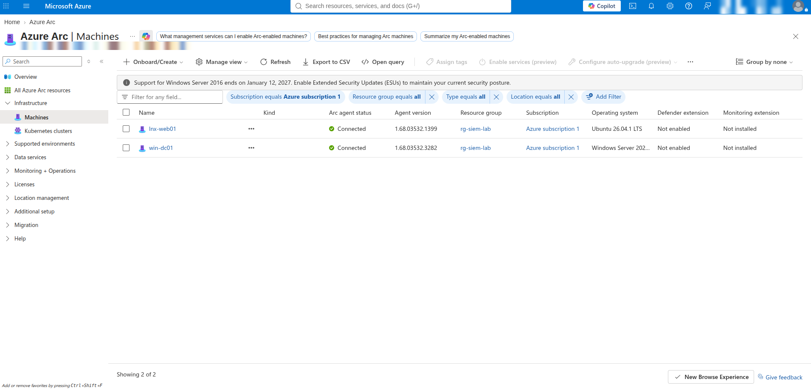

<details>
<summary>More setup screenshots</summary>

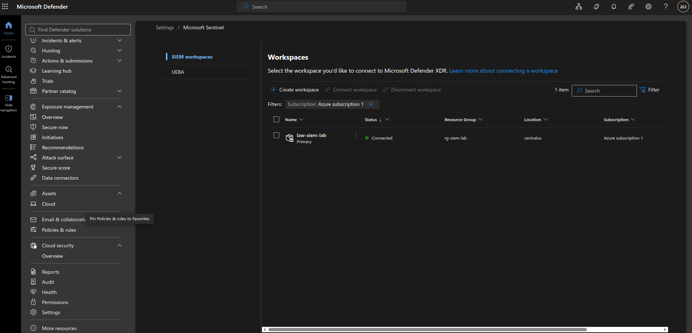

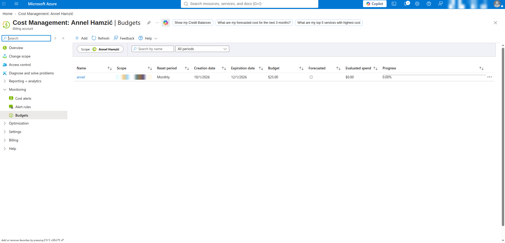

</details>

---

## Getting the logs in

I installed the **Windows Security Events via AMA** and **Syslog via AMA** connectors and made a data collection rule for each VM:

| Rule | Collects | Table |
|---|---|---|
| `dcr-windows-security` | Windows security events, "Common" set | `SecurityEvent` |
| `dcr-linux-syslog` | Only the `auth` and `authpriv` facilities at INFO and up. I left everything else off to keep ingestion small. | `Syslog` |

<details>
<summary>Data collection rule screenshots</summary>

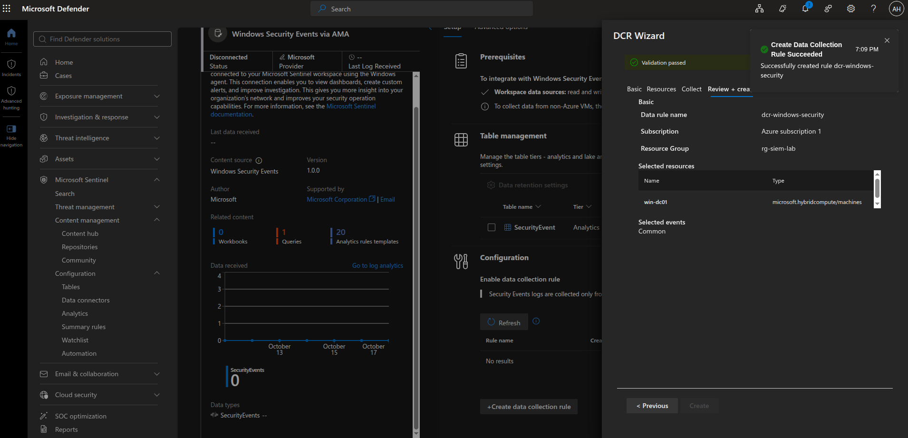

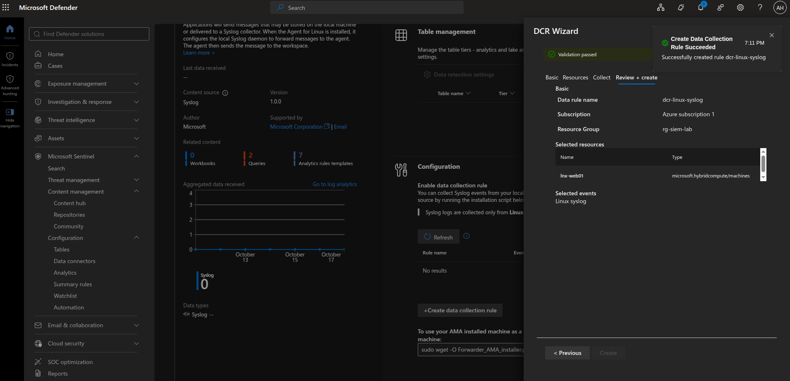

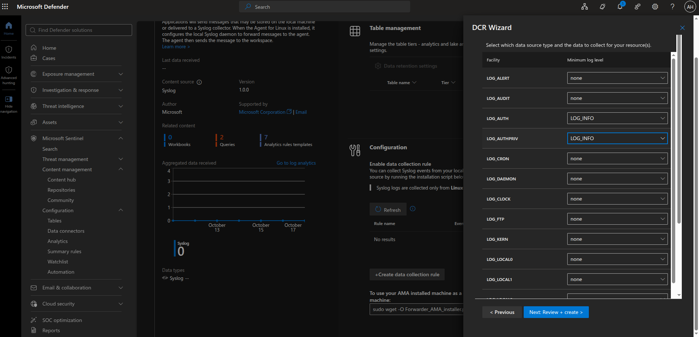

</details>

Creating the rules installs the Azure Monitor Agent on the machines automatically. Failed logons weren't showing up on Windows at first, so I turned on failure auditing.

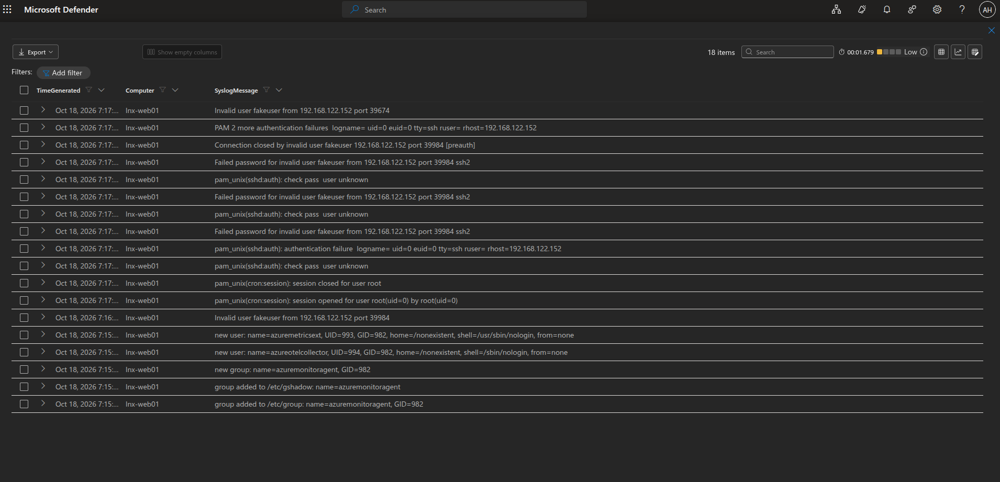

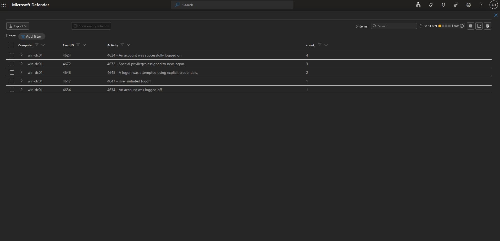

---

## Detection rules

All three are scheduled rules that run every 5 minutes. The KQL is in [`detections/sentinel/`](detections/sentinel/).

| Rule | Triggers on | Severity |
|---|---|---|
| Linux - SSH Brute Force Attempt | 5+ failed SSH passwords from one IP in 10 min | Medium |
| Windows - Multiple Failed Logons | 5+ Event ID 4625 for one account in 10 min | Medium |
| Windows - User Added to Administrators | Event ID 4732 for the Administrators group | High |

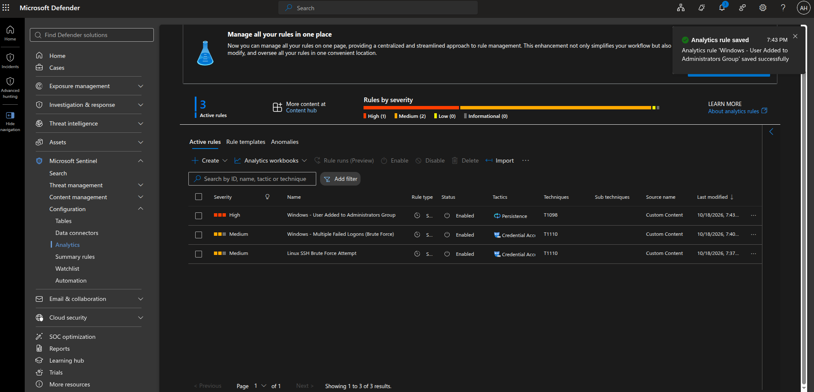

<details>
<summary>Rule configuration screenshots</summary>

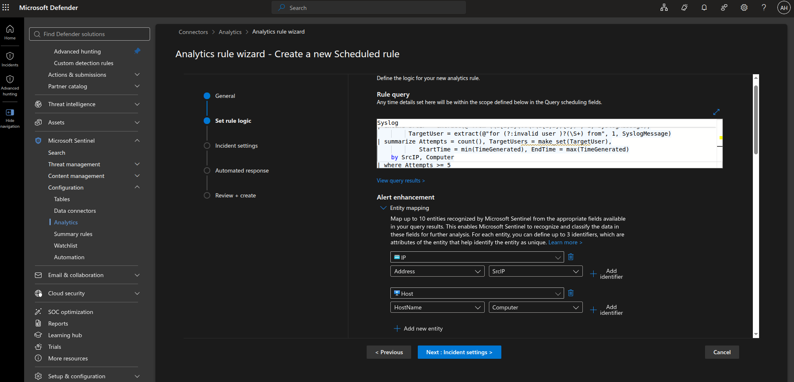

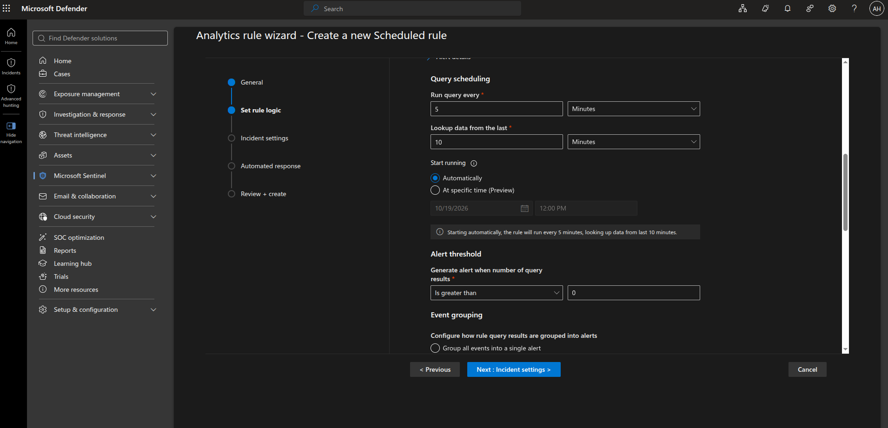

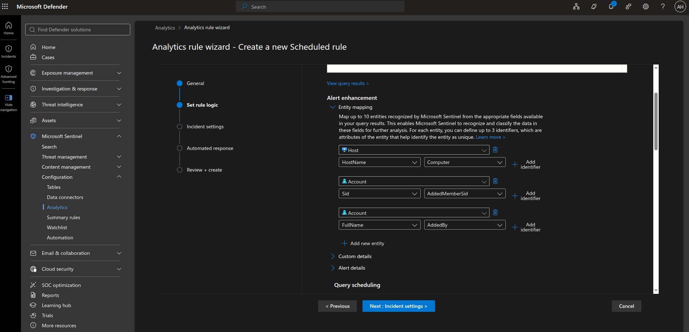

</details>

---

## Testing

### Linux

From my laptop I ran a loop of SSH logins with a fake user and blank passwords.

### Windows

[`Invoke-AttackSimulation.ps1`](scripts/powershell/Invoke-AttackSimulation.ps1) does two things. It generates 10 failed logons against an account that doesn't exist, and it creates a temporary user, adds it to Administrators, waits a minute, then deletes it. It only runs on `win-dc01` unless you pass `-Force`, and it always removes the test user, even if it errors out partway.

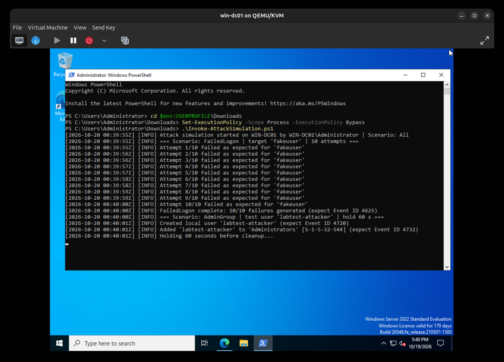

### Results

All three rules fired:

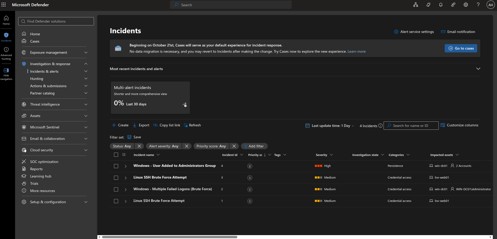

<details>
<summary>Incident details</summary>

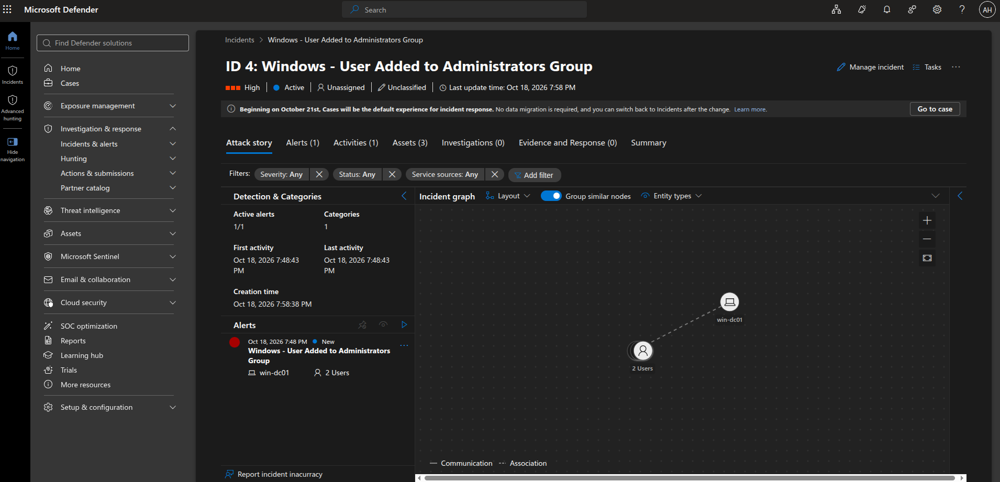

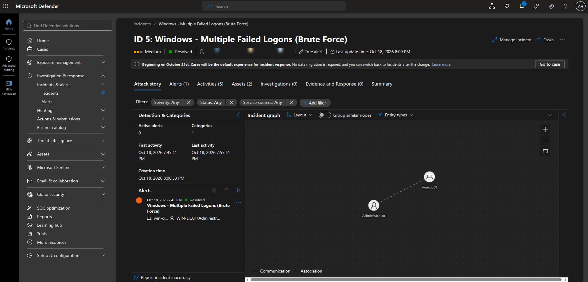

</details>

---

## Python report

[`sentinel_report.py`](scripts/python/sentinel_report.py) queries the workspace with the Azure Monitor Query SDK and prints a summary. It shows which hosts are still sending logs, the incidents, the SSH and Windows failed logins (flagging anything over the rule thresholds), and any Administrators group changes. It also saves the report as a Markdown file.

```bash
cd scripts/python
python3 -m venv .venv && source .venv/bin/activate
pip install -r requirements.txt
cp .env.example .env    # put your workspace ID in here
az login
python sentinel_report.py --hours 24
```

It signs in with your `az login` session, so there are no keys in the code.

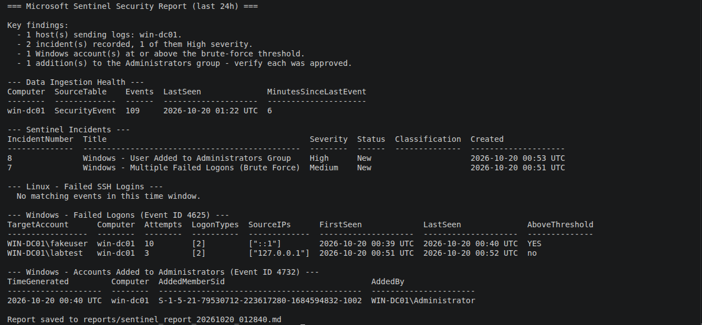

---

## Problems I ran into

**No VM quota.** The new subscription had 0 cores allowed for the B-series v2 VMs in Central US. Instead of waiting on a quota request, I switched to local VMs with Azure Arc.

**Bad hostname.** The Windows VM joined Arc as `WIN-0H3FMF513V7`. I disconnected it, renamed it to `win-dc01`, and reconnected it before collecting any logs, so all the data has the right name.

**Sentinel menus missing.** After connecting the workspace to the Defender portal, the Sentinel menus took a while to show up.

**Expensive image.** The first Windows image I picked was a third-party marketplace image estimated at over $1,100 a month. I caught it on the cost estimate before deploying.

---

## What I'd add next

- Alert grouping to stop the duplicate incidents
- More rules: security log cleared (1102), new service installed (7045), and a successful login right after a burst of failures
